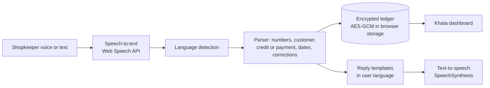

# Voice Khata – बोलो, खाता लिखो

An AI-powered digital accounting system and voice-first udhaar (credit) ledger for kirana stores. The shopkeeper speaks or types an entry mid-sale, and the khata updates itself and answers back by voice, in the same language.

> Built for PS2 · Voice Khata for kirana stores (Innovation Challenge by Gnani.ai and HackBriven).

## Run it

No build step. Open `Voice Khata.html` in Chrome, Edge or Safari (HTTPS or `localhost` is needed for the microphone and encryption).

```bash
git clone https://github.com/gowdavikitha886-hue/voice-khata.git && cd voice-khata
python3 -m http.server 8000      # then open http://localhost:8000/Voice%20Khata.html
```

1. Type any shop name and a PIN of 4+ digits, then press **Log in / Create khata**. A new name creates an encrypted khata with synthetic sample customers.
2. Tap the mic (or type) and try the example chips.
3. **Logout** clears everything from memory. **Erase all my data** deletes the stored ledger.

## Features

| Requirement | How it works |
|---|---|
| Numbers under noise | Streaming speech recognition (Web Speech API) with live interim text. Parser understands `340`, `three-forty`, `teen sau chaalis`, `1,200`, `do hazaar` |
| Ledger logic | Extracts customer, amount, credit or payment, and relative dates (`kal`, `parso`, `aaj`) from one sentence. `Ramesh ka 340 udhaar, kal 200 diya tha` creates two entries |
| Spoken corrections | `Nahi, 430` fixes the last entry |
| Same-name customers | Asks a short spoken question: "Which one: Ramesh Sharma / Ramesh Kumar?" |
| Spoken answers | `Aaj kitna udhaar gaya?`, `Ramesh ka total?` answered instantly; the latency in ms is shown on each reply |
| Any language | Replies follow the language you speak or type (script detection plus Hinglish detection). Full reply templates: English, Hindi, Kannada, Tamil, Telugu, Malayalam. 29 languages are selectable for mic and voice |
| Selling advice | Ask `How to sell biscuits?` (or in Hindi, Kannada, Tamil, Telugu, Malayalam) and get a short spoken answer |
| Login / logout | PIN-based, per-shop khata |
| Typed input | Text box beside the mic |

## Responsible AI and compliance checklist

- **AI disclosure:** the first spoken and written turn after login says it is an AI, in the user’s language.
- **Data:** synthetic sample data only. The ledger is encrypted at rest with AES-GCM; the key comes from the PIN (PBKDF2, 100k iterations) and never leaves the device. "Erase all my data" supports deletion after judging (DPDP Act).
- **Money:** no lending. Reminders are polite, opt-in per customer, with no pressure or threat language.
- **Health:** not applicable; no medical advice.
- **Secrets:** no API key in the client. If you add Gnani API Platform services, call them from a small backend and keep the key in `.env`, which must be listed in `.gitignore`.
- **Voices:** uses the device’s built-in voices; no voice cloning.

## Architecture



### Using Gnani API Platform services

The browser speech APIs are the default so the prototype runs anywhere. To upgrade, replace `startRec()` with streaming speech-to-text from the Gnani API Platform and `speak()` with its text-to-speech, routed through a backend proxy. Check the platform docs for the exact services and endpoints you use and list them here for the submission.

## UI/UX design notes (for your Figma file)

- **Concept:** a paper khata book. Ruled blue lines, a red margin line on the ledger, a shop-signboard heading face.
- **Tokens:** ink `#14213d`, brand blue `#2740a6`, marigold `#f2a900`, due red `#b42318`, paid green `#18794e`, paper `#e9efe6`. Dark mode is included.
- **Type:** Yatra One for headings (Devanagari and Latin), Mukta for body.
- **Frames to draw:** Login · Talk and ledger (desktop) · Talk and ledger (mobile, single column).
- **Accessibility:** visible focus, reduced-motion respected, large mic target (84 px).

## Limitations

- Speech recognition quality depends on the browser and its language pack. Number words are parsed in Latin script (Hindi-in-Roman and English); other scripts work best when the recogniser returns digits.
- Reply templates exist for six languages. Add more by extending the `T` object in `Voice Khata.html`.

## Submission checklist

- [ ] Working prototype link or this repo
- [ ] Public GitHub repo with this README
- [ ] 2–3 minute demo: login, an entry, a correction, a same-name question, a spoken balance, a selling tip
- [ ] Post the demo video on X, explain the key features, tag **@GnaniAI** and **@HackBriven**, copy the post link and submit it through the form with your project details

## Team

TEAM ELIVET
